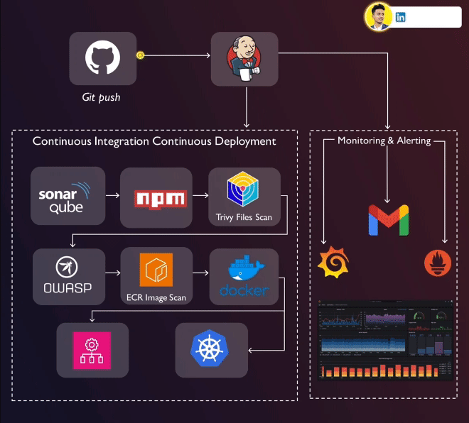
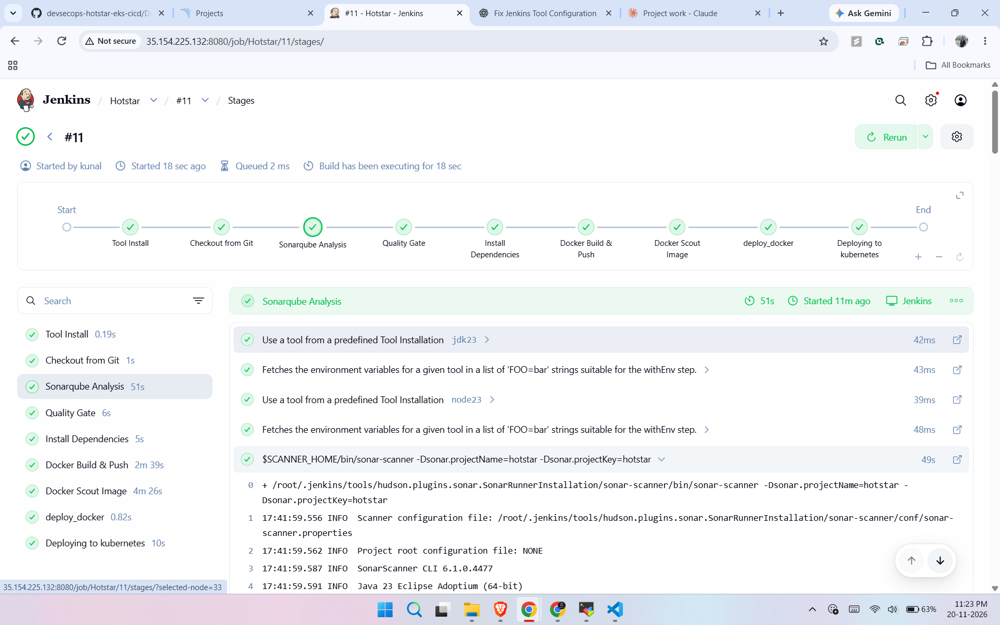
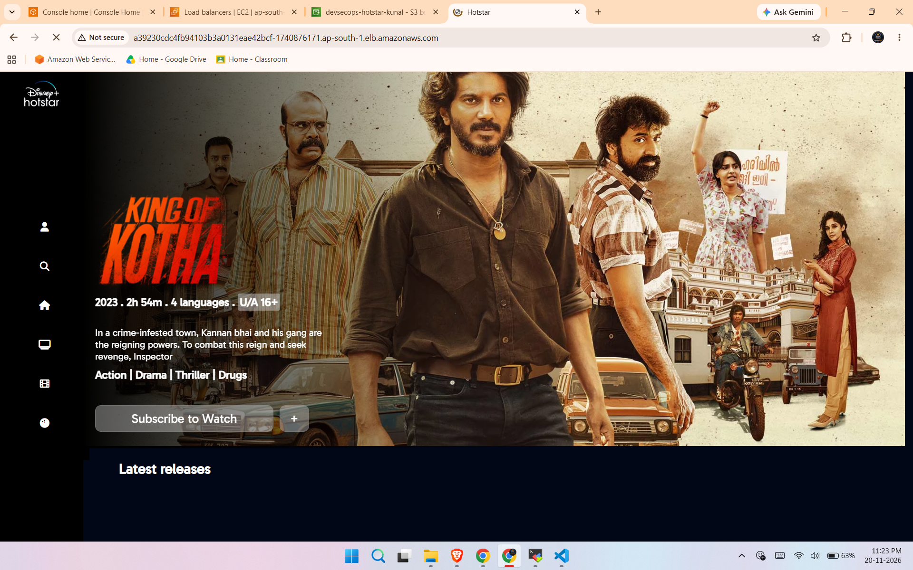
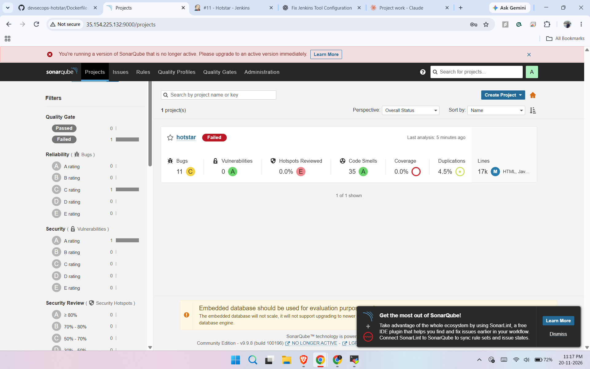
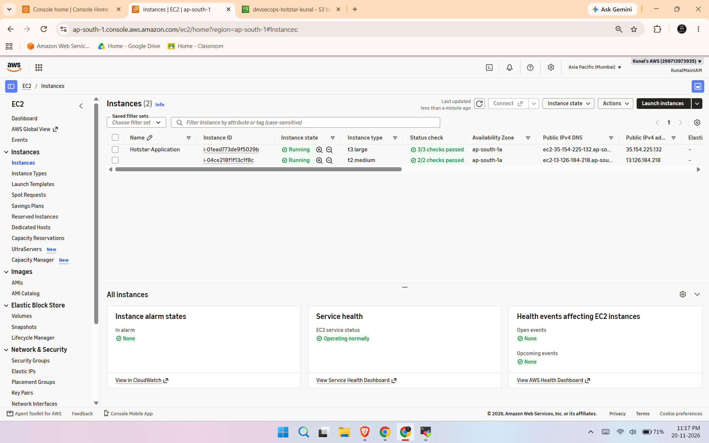
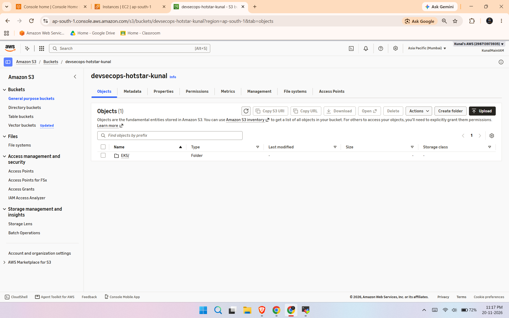

# DevSecOps Hotstar - CI/CD on AWS EKS


A hands-on DevSecOps project that builds, scans, and deploys a Hotstar-style streaming clone through an automated Jenkins pipeline into Amazon Elastic Kubernetes Service (EKS).

> **Repository scope:** this repository contains the architecture assets and the complete deployment guide. Add the application source, Dockerfile, Terraform configuration, Jenkinsfiles, and Kubernetes manifests to the repository before using the automation as a fully version-controlled infrastructure project.

---

## Table of Contents

- [Project Overview](#project-overview)
- [Architecture](#architecture)
- [CI/CD and Security Workflow](#cicd-and-security-workflow)
- [Technology Stack](#technology-stack)
- [Repository Structure](#repository-structure)
- [Prerequisites](#prerequisites)
- [AWS Infrastructure Setup](#aws-infrastructure-setup)
- [Jenkins Configuration](#jenkins-configuration)
- [Application Pipeline](#application-pipeline)
- [Deployment Verification](#deployment-verification)
- [Screenshots](#screenshots)
- [Security Best Practices](#security-best-practices)
- [Cost and Cleanup](#cost-and-cleanup)
- [Troubleshooting](#troubleshooting)

---

## Project Overview

The project demonstrates an end-to-end DevSecOps delivery workflow:

1. A developer pushes application code to GitHub.
2. Jenkins checks out the source and runs SonarQube analysis.
3. Jenkins enforces a quality gate and installs Node.js dependencies.
4. OWASP Dependency-Check scans project dependencies.
5. Docker builds and publishes the application image.
6. Docker Scout analyzes the image for vulnerabilities.
7. Kubernetes deploys the validated image to AWS EKS.
8. AWS exposes the application through a LoadBalancer service.

The setup separates infrastructure creation from application deployment:

| Jenkins Job | Responsibility |
|---|---|
| **EKS Provision** | Initializes, validates, plans, applies, or destroys Terraform infrastructure |
| **Hotstar Application** | Tests, scans, builds, publishes, and deploys the application |

## Architecture


<p align="center">
  
</p>

The architecture uses an Ubuntu EC2 instance as the Jenkins and automation host. Jenkins coordinates Terraform, SonarQube, OWASP Dependency-Check, Docker, Docker Scout, and kubectl. A GitHub repository supplies source code, while AWS EKS runs the deployed application.

## CI/CD and Security Workflow

```text
GitHub
  |
  v
Jenkins Pipeline
  |
  +--> Checkout
  +--> SonarQube Static Analysis
  +--> Quality Gate
  +--> npm Dependency Installation
  +--> OWASP Dependency-Check
  +--> Docker Build and Push
  +--> Docker Scout Image Scan
  +--> Docker Container Validation
  +--> Kubernetes Deployment
            |
            v
       AWS EKS Cluster
            |
            v
       LoadBalancer Service
```

### Security checks

- **SonarQube:** static code analysis and quality metrics
- **OWASP Dependency-Check:** vulnerable third-party dependency detection
- **Docker Scout:** container image vulnerability and recommendation analysis
- **Docker and Kubernetes credentials:** stored as Jenkins credentials rather than embedded in pipeline commands

## Technology Stack

| Area | Technology |
|---|---|
| Cloud | Amazon Web Services |
| Compute | EC2, Amazon EKS |
| Infrastructure as Code | Terraform |
| CI/CD | Jenkins |
| Source Control | Git and GitHub |
| Containers | Docker |
| Orchestration | Kubernetes |
| Code Quality | SonarQube |
| Application Security | OWASP Dependency-Check |
| Container Security | Docker Scout |
| CLI and Automation | AWS CLI, kubectl |
| Application Runtime | Node.js / npm |
| Java Runtime | Eclipse Temurin JDK |
| Storage | Amazon S3 Terraform backend |

## Repository Structure

```text
.
|-- Architecture.png                 # Architecture diagram
|-- archi-hotstar.gif               # Architecture walkthrough
|-- DevSecOps-Hotstar.txt           # Original setup and Jenkins pipeline guide
|-- README.md                       # Project documentation
|-- secrets.txt                     # Sensitive Kubernetes kubeconfig (do not reuse or commit)
`-- Screenshoots/
    |-- ec2-instances.png
    |-- s3-bucket.png
    |-- sonarqube.png
    |-- website.png
    |-- jenkins-pipeline.png
    |-- ci/
    `-- complete-ci/
```

## Prerequisites

### AWS

- An AWS account with permissions for EC2, EKS, IAM, S3, and VPC resources
- AWS CLI installed and configured
- An S3 bucket for the Terraform remote state

### Local workstation

- Git
- AWS CLI
- kubectl
- Terraform
- Docker
- An SSH client

### Jenkins host

Use an Ubuntu EC2 instance with at least:

- `t2.large`
- 30 GB or more storage
- SSH access
- Docker access
- An IAM role limited to the required AWS permissions

> Avoid broad administrative roles in production. Use IAM roles and least-privilege policies for Jenkins.

## AWS Infrastructure Setup

### 1. Launch the Jenkins EC2 instance

Launch an Ubuntu EC2 instance, attach an instance profile, open only the required security group ports, and connect through SSH.

Suggested Jenkins host ports:

| Port | Purpose |
|---:|---|
| 22 | SSH |
| 8080 | Jenkins |
| 9000 | SonarQube |
| 3000 | Hotstar application container |

### 2. Install Jenkins, Java, Docker, Terraform, kubectl, and AWS CLI

The commands and installation sequence are documented in [DevSecOps-Hotstar.txt](DevSecOps-Hotstar.txt).

After installation:

```bash
java --version
docker --version
jenkins --version
terraform --version
kubectl version --client
aws --version
```

Restart and grant Docker access to the Jenkins service as required:

```bash
sudo systemctl daemon-reload
sudo systemctl restart docker.service
sudo chmod 666 /var/run/docker.sock
```

Do not use `chmod 666` on a shared or production host. Prefer Docker group membership and appropriate service-account permissions.

### 3. Start SonarQube

```bash
docker run -d --name sonar -p 9000:9000 sonarqube:lts-community
```

Open `http://<EC2-PUBLIC-IP>:9000` and change the default administrator credentials.

## Jenkins Configuration

### Install Jenkins plugins

Install and configure:

- Eclipse Temurin Installer
- SonarQube Scanner
- NodeJS
- OWASP Dependency-Check
- Docker, Docker Commons, Docker Pipeline, and Docker API
- Kubernetes Credentials Provider
- Kubernetes CLI

### Configure Jenkins tools

Create named tool installations for:

- JDK
- Node.js
- SonarQube Scanner
- OWASP Dependency-Check
- Docker
- Terraform

Tools should be reachable by Jenkins and all configured build agents.

### Add Jenkins credentials

Create the following credential IDs without placing secrets in pipeline source code:

| ID | Type | Purpose |
|---|---|---|
| `sonar-token` | Secret text | SonarQube authentication |
| `docker` | Username and password | Docker registry authentication |
| `k8s` | Secret file | EKS kubeconfig |

Configure SonarQube in **Manage Jenkins > System** and register a webhook from SonarQube to Jenkins.

## Application Pipeline

Create a parameterized Jenkins pipeline named `EKSJOB` for infrastructure with an `action` parameter:

```text
apply
destroy
```

The infrastructure stages should:

1. Check out the Terraform repository.
2. Verify the Terraform CLI.
3. Run `terraform init`.
4. Run `terraform validate`.
5. Run `terraform plan`.
6. Run `terraform apply` or `terraform destroy`.

Create a second pipeline for application delivery. It should run these stages:

```text
Checkout
SonarQube Analysis
Quality Gate
npm Install
OWASP FS Scan
Docker Build
Docker Push
Docker Scout Image Scan
Docker Container Deployment
Kubernetes Deployment
```

Example Kubernetes deployment commands:

```bash
kubectl apply -f K8S/deployment.yml
kubectl apply -f K8S/service.yml
```

The full Jenkins pipeline examples are available in [DevSecOps-Hotstar.txt](DevSecOps-Hotstar.txt).

## Deployment Verification

After configuring AWS credentials and the kubeconfig:

```bash
aws eks update-kubeconfig \
  --name EKS_CLUSTER \
  --region ap-south-1

kubectl get nodes
kubectl get all
kubectl get svc -o wide
```

Open the external address shown by the LoadBalancer service in a browser:

```text
http://<EXTERNAL-LOAD-BALANCER-DNS>
```

## Screenshots

### Jenkins Pipeline


### Successful CI/CD Pipeline



### Docker and Jenkins Workflow


### Deployed Website



### SonarQube Analysis



### AWS Resources

| EC2 Instances | Terraform State Bucket |
|---|---|
|  |  |

## Security Best Practices

### Rotate committed secrets

The repository currently tracks `secrets.txt`, which contains Kubernetes cluster configuration. Treat it as exposed credential material:

1. Remove it from Git tracking.
2. Revoke or rotate cluster credentials and tokens that were committed.
3. Store the kubeconfig in Jenkins credentials or a secrets manager.
4. Add `secrets.txt`, kubeconfigs, `.env` files, and private keys to `.gitignore`.

Because Git retains file history, removing a file in a later commit does not remove it from existing history. Purge exposed credentials and rotate AWS keys when necessary.

### Use least privilege

- Use a scoped Jenkins IAM role.
- Use Kubernetes RBAC.
- Scan every image before deployment.
- Pin image tags or digests rather than deploying `latest` in production.
- Protect Jenkins credentials and restrict pipeline configuration permissions.
- Add Trivy as an additional filesystem, container, and Kubernetes IaC scanner if required.

## Cost and Cleanup

EKS, EC2, Elastic Load Balancers, NAT gateways, and other AWS resources can incur continuous costs.

Run the infrastructure Jenkins job with the `destroy` action, or destroy the Terraform configuration directly:

```bash
cd EKS_TERRAFORM
terraform destroy --auto-approve
```

Also remove:

- Docker and container resources
- Jenkins jobs and credentials
- S3 Terraform state resources
- ECR or Docker Hub images
- LoadBalancer and unused VPC resources

## Troubleshooting

### Jenkins cannot access Docker

```bash
sudo systemctl restart docker.service
sudo usermod -aG docker jenkins
sudo systemctl restart jenkins
```

Then confirm that Jenkins can run Docker:

```bash
docker run --rm hello-world
```

### SonarQube quality gate fails or times out

- Verify SonarQube is reachable from Jenkins.
- Confirm the SonarQube webhook URL.
- Confirm the `sonar-token` credential.
- Review project metrics in the SonarQube dashboard.

### Kubernetes deployment is rejected

```bash
kubectl get pods
kubectl describe pod <POD-NAME>
kubectl logs <POD-NAME>
kubectl get events --sort-by=.metadata.creationTimestamp
```

Verify the kubeconfig, AWS identity, EKS cluster name, region, namespace, and RBAC permissions.

### LoadBalancer has no external address

Confirm that AWS can provision the service and that subnet and security group settings allow internet-facing traffic:

```bash
kubectl describe svc <SERVICE-NAME>
kubectl get endpoints
```

---

## License

Add a license that matches how the project and application assets are intended to be reused. At present, no license file is included in the repository.
