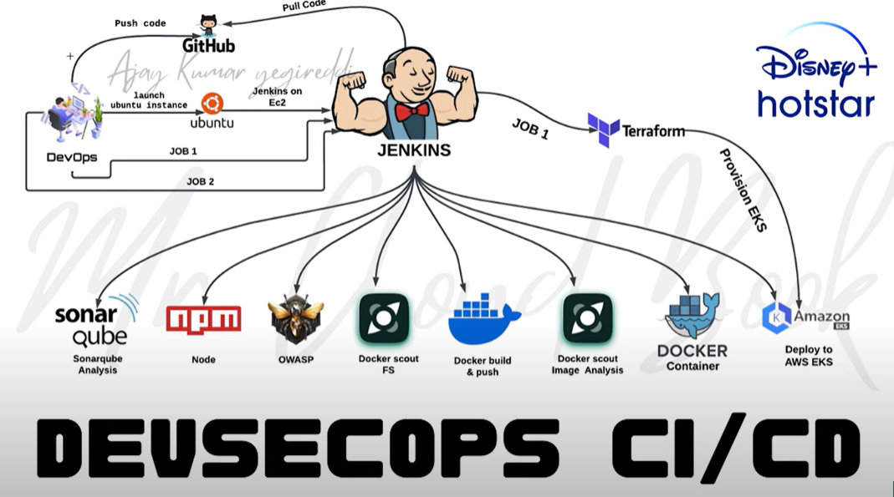
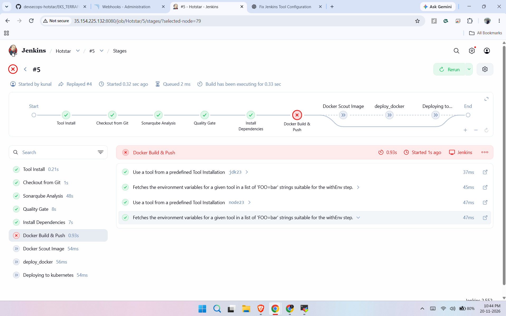
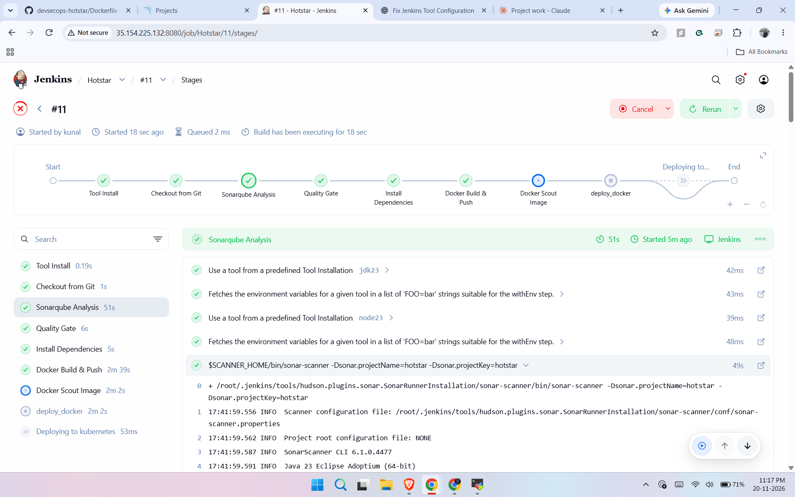

# DevSecOps Hotstar

[](https://aws.amazon.com/)
[](https://www.jenkins.io/)
[](https://www.docker.com/)
[](https://kubernetes.io/)
[](https://www.terraform.io/)
[](https://www.sonarsource.com/products/sonarqube/)

> An end-to-end DevSecOps implementation that provisions AWS infrastructure and deploys a Hotstar-style streaming application through a secured CI/CD pipeline.

---

## Table of Contents

- [Overview](#overview)
- [Architecture](#architecture)
- [DevSecOps Workflow](#devsecops-workflow)
- [Technology Stack](#technology-stack)
- [Repository Content](#repository-content)
- [Prerequisites](#prerequisites)
- [Infrastructure and Jenkins Setup](#infrastructure-and-jenkins-setup)
- [CI/CD Pipelines](#cicd-pipelines)
- [Deployment Verification](#deployment-verification)
- [Screenshots](#screenshots)
- [Security](#security)
- [Cost and Cleanup](#cost-and-cleanup)
- [Troubleshooting](#troubleshooting)
- [Author](#author)

---

## Overview

This project demonstrates how application delivery can combine continuous integration, continuous deployment, infrastructure as code, and security validation.

The implementation uses:

- Amazon EC2 for the Jenkins automation host
- Amazon EKS for Kubernetes workloads
- Jenkins for CI/CD orchestration
- Terraform for infrastructure provisioning
- SonarQube for static code analysis
- OWASP Dependency-Check for dependency scanning
- Docker and Docker Scout for image security
- Amazon S3 for Terraform remote state

> **Repository scope:** this repository currently contains the architecture assets and deployment guide. Add the application source, Dockerfile, Terraform configuration, Jenkinsfiles, and Kubernetes manifests before running the pipeline as a complete, version-controlled project.

---

## Architecture



<p align="center">
  
</p>

The Jenkins EC2 instance acts as the central automation server. Jenkins retrieves application code from GitHub, performs quality and vulnerability checks, builds and publishes container images, and deploys validated workloads to Amazon EKS.

---

## DevSecOps Workflow

```text
Developer
   |
   | Push
   v
GitHub
   |
   v
Jenkins Pipeline
   |
   +--> Checkout source code
   +--> SonarQube static analysis
   +--> Quality gate
   +--> Install dependencies
   +--> OWASP Dependency-Check
   +--> Build Docker image
   +--> Push image to registry
   +--> Docker Scout image scan
   +--> Deploy Docker container
   +--> Deploy to Amazon EKS
              |
              v
        Kubernetes Service
              |
              v
      LoadBalancer Public Endpoint
```

### Security controls

| Control | Tool | Purpose |
|---|---|---|
| Static analysis | SonarQube | Detect code defects and quality issues |
| Dependency scanning | OWASP Dependency-Check | Identify vulnerable application dependencies |
| Container scanning | Docker Scout | Report image vulnerabilities and remediation guidance |
| Secrets management | Jenkins Credentials | Keep tokens and registry credentials outside pipeline code |
| Cluster access | Kubernetes credentials | Restrict and manage EKS authentication |
| Infrastructure | Terraform | Reproduce infrastructure consistently |

---

## Technology Stack

| Category | Technologies |
|---|---|
| Cloud | Amazon Web Services |
| Compute | Amazon EC2, Amazon EKS |
| Infrastructure as Code | Terraform |
| CI/CD | Jenkins |
| Source Control | Git and GitHub |
| Containers | Docker |
| Orchestration | Kubernetes |
| Code Quality | SonarQube |
| Application Security | OWASP Dependency-Check |
| Container Security | Docker Scout |
| Runtime | Node.js / npm |
| Java | Eclipse Temurin JDK |
| CLI | AWS CLI, kubectl |
| Remote State | Amazon S3 |

---

## Repository Content

```text
.
|-- Architecture.png
|-- archi-hotstar.gif
|-- DevSecOps-Hotstar.txt
|-- README.md
|-- secrets.txt                   # Sensitive - rotate and remove from Git history
`-- Screenshoots/
    |-- ec2-instances.png
    |-- s3-bucket.png
    |-- sonarqube.png
    |-- website.png
    |-- jenkins-pipeline.png
    |-- ci/
    `-- complete-ci/
```

---

## Prerequisites

### AWS

- An AWS account with permissions for EC2, EKS, IAM, S3, and VPC resources
- AWS CLI installed and configured
- A dedicated S3 bucket for Terraform remote state

### Local workstation

- Git
- AWS CLI
- kubectl
- Terraform
- Docker
- An SSH client

### Jenkins host

Use an Ubuntu EC2 instance with:

- `t2.large` or a suitable larger instance
- At least 30 GB of storage
- Restricted SSH and application security group rules
- A scoped IAM role following least-privilege principles

---

## Infrastructure and Jenkins Setup

The complete, redacted installation and configuration procedure is available in [DevSecOps-Hotstar.txt](DevSecOps-Hotstar.txt).

### 1. Launch the EC2 automation host

Create an Ubuntu EC2 instance, attach a least-privilege instance role, and open only the required ports:

| Port | Purpose |
|---:|---|
| 22 | SSH administration |
| 8080 | Jenkins |
| 9000 | SonarQube |
| 3000 | Local application validation |

### 2. Install the required tools

Install:

- Eclipse Temurin JDK
- Jenkins
- Docker
- SonarQube
- AWS CLI
- kubectl
- Terraform

Verify each installation before continuing:

```bash
java --version
docker --version
jenkins --version
terraform --version
kubectl version --client
aws --version
```

### 3. Start SonarQube

```bash
docker run -d --name sonar -p 9000:9000 sonarqube:lts-community
```

Open `http://<EC2-PUBLIC-IP>:9000`, change the default credentials, and create an administrator token for Jenkins.

### 4. Configure Jenkins

Install the following plugins:

- Eclipse Temurin Installer
- SonarQube Scanner
- Node.js
- OWASP Dependency-Check
- Docker, Docker Commons, Docker Pipeline, and Docker API
- Kubernetes Credentials Provider
- Kubernetes CLI

Configure named tools for JDK, Node.js, SonarQube Scanner, OWASP Dependency-Check, Docker, and Terraform.

Create Jenkins credentials using these IDs:

| Credential ID | Type | Purpose |
|---|---|---|
| `sonar-token` | Secret text | SonarQube authentication |
| `docker` | Username and password | Container registry authentication |
| `k8s` | Secret file | EKS kubeconfig |

Never store credentials in Jenkinsfiles or application source files.

---

## CI/CD Pipelines

### Infrastructure pipeline

Create a parameterized pipeline named `EKSJOB` with an `action` parameter:

```text
apply
destroy
```

The pipeline stages are:

1. Checkout Terraform source
2. Verify the Terraform CLI
3. Initialize the backend
4. Validate configuration
5. Create an execution plan
6. Apply or destroy infrastructure

Before running the pipeline, update the S3 backend and cluster variables in the Terraform configuration.

### Application pipeline

Create a pipeline named `HOTSTAR` with these stages:

```text
Checkout
SonarQube Analysis
Quality Gate
Install Dependencies
OWASP FS Scan
Docker Build
Docker Push
Docker Scout Scan
Docker Container Deployment
Kubernetes Deployment
```

Deploy Kubernetes resources from the pipeline:

```bash
kubectl apply -f K8S/deployment.yml
kubectl apply -f K8S/service.yml
```

Example Jenkins syntax for kubeconfig-based deployment:

```groovy
withKubeConfig(credentialsId: 'k8s') {
    sh 'kubectl apply -f K8S/deployment.yml'
    sh 'kubectl apply -f K8S/service.yml'
}
```

---

## Deployment Verification

Configure the local kubeconfig:

```bash
aws eks update-kubeconfig \
  --name <EKS_CLUSTER_NAME> \
  --region <AWS_REGION>
```

Verify the deployment:

```bash
kubectl get nodes
kubectl get all
kubectl get pods
kubectl get svc -o wide
```

Open the external LoadBalancer address printed by `kubectl get svc`:

```text
http://<EXTERNAL-LOAD-BALANCER-DNS>
```

---

## Screenshots

### Jenkins Pipeline



### Successful CI/CD Pipeline


### Docker and Jenkins Workflow



### Deployed Website


### SonarQube Analysis


### AWS Resources

| EC2 Instances | Terraform State Bucket |
|---|---|
|  |  |

---

## Security

### Secret and credential hygiene

The repository tracks `secrets.txt`. Treat any committed kubeconfig or token as exposed:

1. Remove `secrets.txt` from Git tracking.
2. Rotate any credentials, tokens, or AWS keys that may have been committed.
3. Store the kubeconfig in Jenkins Credentials or a secrets manager.
4. Add kubeconfigs, `.env` files, private keys, and secret text files to `.gitignore`.

Removing a file in a later commit does not remove it from Git history. Purge the secret and rotate credentials if sensitive values were exposed.

### Production hardening

- Use scoped IAM roles instead of administrator access.
- Enable Kubernetes RBAC and namespace separation.
- Pin application image tags or digests.
- Fail the pipeline on severe dependency or image findings.
- Restrict Jenkins credentials and build permissions.
- Enable AWS audit logging and regular key rotation.
- Use Trivy for additional filesystem, container, Kubernetes, and IaC scanning.
- Avoid broad Docker socket permissions on shared or production hosts.

---

## Cost and Cleanup

EKS, EC2, Elastic Load Balancers, NAT gateways, and supporting resources can incur ongoing AWS charges.

Destroy infrastructure using the Jenkins `destroy` action or run Terraform directly:

```bash
cd EKS_TERRAFORM
terraform destroy --auto-approve
```

After destruction, review AWS for:

- Stopped or orphaned EC2 instances
- Remaining load balancers
- NAT gateways
- Unused security groups and volumes
- Container registry images
- Terraform state and state-lock resources
- Jenkins jobs and credentials

---

## Troubleshooting

### Jenkins cannot access Docker

```bash
sudo usermod -aG docker jenkins
sudo systemctl restart docker.service
sudo systemctl restart jenkins
```

Verify Docker from Jenkins:

```bash
docker run --rm hello-world
```

### SonarQube quality gate fails or times out

- Confirm SonarQube is reachable from Jenkins.
- Verify the SonarQube webhook URL.
- Confirm the `sonar-token` credential is valid.
- Review metrics in the SonarQube project dashboard.

### Kubernetes deployment fails

```bash
kubectl get pods
kubectl describe pod <POD-NAME>
kubectl logs <POD-NAME>
kubectl get events --sort-by=.metadata.creationTimestamp
```

Check the kubeconfig, AWS identity, cluster name, region, namespace, and RBAC permissions.

### LoadBalancer has no external address

```bash
kubectl describe service <SERVICE-NAME>
kubectl get endpoints
```

Verify subnet configuration, AWS service quotas, IAM permissions, and internet-facing traffic rules.

---

## Author

**Kunal Jadhav**

- **Portfolio:** [kunalcloud.shop](https://kunalcloud.shop/)
- **GitHub:** [@devkunaljadhav](https://github.com/devkunaljadhav)
- **LinkedIn:** [Kunal Jadhav](https://www.linkedin.com/in/devkunaljadhav)
- **Email:** [kunaljadhav1625@gmail.com](mailto:kunaljadhav1625@gmail.com)

---

## License

No license file is currently included. Add a license that defines how the project source and documentation may be used before publishing or distributing the project.
